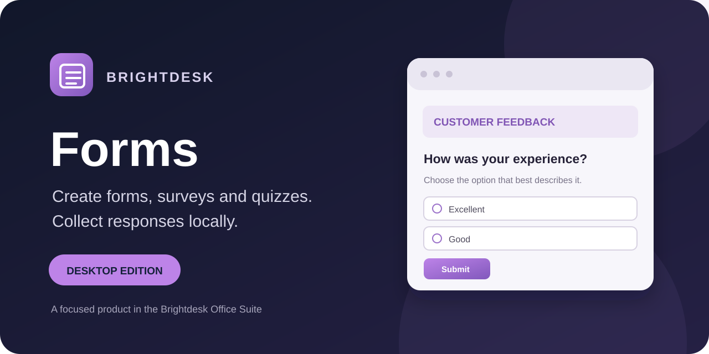

# Brightdesk Forms




Create forms, surveys and quizzes, then collect responses locally.

Brightdesk Forms is a focused desktop productivity tool within the Brightdesk Office Suite. This repository contains the source, quality checks and platform build configuration for the Forms desktop edition.

## What it does

- Design and organise forms, surveys and quizzes.
- Collect responses locally.
- Work with the shared Brightdesk file, language and dictionary services.
- Use the same Brightdesk design language and desktop experience.

## Requirements

- Node.js **24.22.2**
- npm
- Git

## Development

```bash
npm ci
npm start
npm test
```

## Desktop builds

The build scripts target Windows, macOS and Linux:

| Platform | Build command |
| --- | --- |
| Windows | `npm run dist:product:win` |
| macOS | `npm run dist:product:mac` |
| Linux | `npm run dist:product:linux` |

Verify a platform build with the matching `npm run verify:product:<platform>` command.

Build output is stored in the Forms product release directory. Platform packaging should be performed on a compatible runner or operating system.

## Quality and security

`npm test` runs the checked-in test suite. The CI workflow verifies the lockfile and third-party licence notices, runs release preflight checks, and audits npm dependencies. The same checks repeat daily through the scheduled workflow.

Dependabot checks npm packages and GitHub Actions weekly.

Publishing a GitHub Release is a separate manual choice and remains disabled by default.

## Scope

Brightdesk Forms is one of the ten approved Brightdesk products. It remains focused on form creation and local response collection. The main suite coordinates the complete product experience.

## Licence

See [LICENSE](LICENSE), [TERMS_AND_CONDITIONS.txt](TERMS_AND_CONDITIONS.txt) and [THIRD_PARTY_NOTICES.md](THIRD_PARTY_NOTICES.md).
