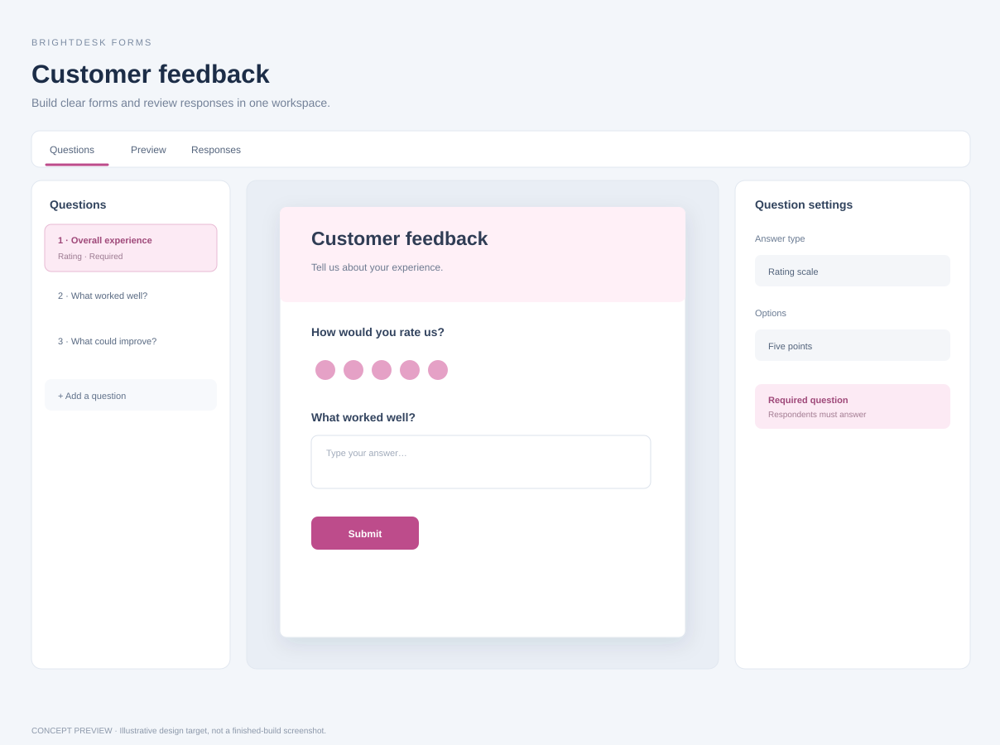

# Brightdesk Forms

<p align="center"><br><strong>brightdesk</strong></p>
<p align="center"></p>

<p align="center"><strong>Create forms, surveys and quizzes, then collect responses locally.</strong></p>

<p align="center"><a href="https://raw.githubusercontent.com/connormolloy12/Brightdesk-Forms/main/src/branding/previews/forms.svg"></a></p>

<p align="center"><sub>Select the preview to open the full-size artwork.</sub></p>

> **Concept artwork — not a screenshot.** The preview above is original Brightdesk design artwork, not a capture from the running desktop build. A genuine screenshot will be added only after the current product window has been launched and its primary workflow checked.

Brightdesk Forms is a dedicated desktop application within the independent Brightdesk Office Suite. It uses the shared Brightdesk design language and opens directly into Forms.

## Current first-use workflows

- Create and edit local form titles and descriptions.
- Add, edit and remove short-answer, long-answer, single-choice, multiple-choice and date questions.
- Mark questions as required and validate submitted answers.
- Preview a form, submit responses on this device, review saved responses and delete individual responses.

**Not included in this first version:** Online publishing, public response links, branching logic, scoring, file attachments, cloud response collection and collaboration.

## Shared Brightdesk design standard

This product follows the [Brightdesk visual and interaction standard](https://github.com/connormolloy12/Brightdesk-suite/blob/main/docs/BRIGHTDESK_VISUAL_STANDARD.md) for branding, icon usage, layout, responsive behaviour and accessibility.

## Requirements

- Node.js **24.22.2**
- npm
- Git

## Development

```bash
npm ci
npm start
npm test
```

## Desktop builds

The build scripts target Windows, macOS and Linux:

| Platform | Build command |
| --- | --- |
| Windows | `npm run dist:product:win` |
| macOS | `npm run dist:product:mac` |
| Linux | `npm run dist:product:linux` |

Verify a platform build with the matching `npm run verify:product:<platform>` command.

Build output is stored in the Forms product release directory. Platform packaging should be performed on a compatible runner or operating system.

## Quality and security

`npm test` runs the checked-in test suite. It includes the Windows NSIS uninstaller-extraction and final visual-branding regression checks. Network-backed dictionary integration remains opt-in. The CI workflow verifies the lockfile and third-party licence notices, runs release preflight checks, and audits npm dependencies. The same checks repeat daily through the scheduled workflow.

Dependabot checks npm packages and GitHub Actions weekly.

Publishing a GitHub Release is a separate manual choice and remains disabled by default.

## Scope

Brightdesk Forms is one of the ten approved Brightdesk products. It remains focused on form creation and local response collection. The main suite coordinates the complete product experience.

## Licence

See [LICENSE](LICENSE), [TERMS_AND_CONDITIONS.txt](TERMS_AND_CONDITIONS.txt) and [THIRD_PARTY_NOTICES.md](THIRD_PARTY_NOTICES.md).
